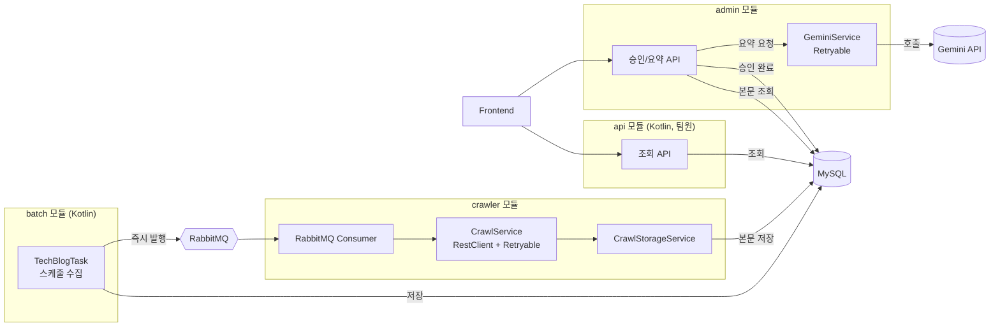

## 담당 역할
 
| 영역 | 내용 |
|---|---|
| **admin 모듈** | 전담 개발 (인증, 승인, 요약 요청 API) |
| **crawler 모듈** | 전담 개발 (수집, 파싱, 재시도) |
| **batch 모듈** | RabbitMQ 발행 로직 담당 (수집 로직은 팀원) |
| **api 모듈** | 미담당 (Kotlin, 팀원) |
| **AWS 인프라** | EC2 / RDS / ECR / Secrets Manager / SSM 구성 |
| **CI/CD** | GitHub Actions 기반 빌드-배포 파이프라인 |
 
## 기술 스택
 
Java 21, Kotlin, Spring Boot, Spring Security, MySQL(RDS), RabbitMQ, Docker, AWS, GitHub Actions
 
## 아키텍처
 

 
**멀티모듈 구조로 관심사 분리** — `api`(조회), `admin`(운영/승인), `crawler`(수집), `batch`(스케줄 수집) 모듈이 독립적으로 배포/관리되도록 설계했습니다.
 
**이벤트 기반 처리** — 기존에는 스케줄러가 1분 주기로 DB를 폴링(최대 10건씩)하는 방식이었으나, batch 모듈이 데이터를 저장하는 즉시 RabbitMQ로 발행하고 crawler가 곧바로 소비하는 구조로 전환했습니다. `crawler` 내부의 재탐색 스케줄러는 발행 실패 시에만 동작하는 보조 안전장치입니다.
 
## 성능 개선
 
| | 기존 (폴링) | 개선 (이벤트 기반) |
|---|---|---|
| 방식 | 1분 주기, 배치당 최대 10건 | 저장 즉시 큐 발행 |
| 50건 처리 소요시간 | 이론상 약 4~5분 (조건: 1분 주기·10건/배치) | **실측 약 2.9초** |
 
> 실측 조건: 동일 대상 URL 50건, 로컬 환경, `@TrackExecutionTime`(AOP) 및 타임스탬프 로그 기반 측정
 
## 트러블슈팅
 
### 1. 사용되지 않는 Virtual Thread Executor 제거
크롤링 성능 개선을 위해 Virtual Thread 기반 Executor를 미리 구성해두었으나, 실제로는 `@RabbitListener` concurrency가 1로 동작해 병렬 처리 구조 자체가 필요 없었습니다. 코드 리뷰 과정에서 어디에도 참조되지 않는 죽은 코드임을 발견하고 제거했습니다.
 
### 2. 재시도 어노테이션이 실제로는 동작하지 않던 문제
Spring Framework의 신규 내장 재시도 기능(`@Retryable`)을 적용했으나, 이를 활성화하는 `@EnableResilientMethods` 설정이 빠져 있어 재시도 로직이 실제로는 전혀 동작하지 않고 있었습니다. 테스트 코드 작성 과정에서 이를 발견하고 설정을 추가해 정상 동작을 확인했습니다.
 
### 3. 승인 정보 조회 메서드 불일치
단건 조회(`getGitHubRelease`)와 상태 일괄 변경(`updateStatus`) 로직에서 승인 정보를 조회하는 리포지토리 메서드가 서로 다르게 설계되어 있음을 인지하지 못한 채 테스트를 작성하다가, 실제로는 참조 대상이 어긋나는 버그를 발견해 수정했습니다.
 
### 4. 외부 응답 인코딩 깨짐
`RestClient`로 크롤링한 HTML 응답의 `Content-Type`에 charset이 명시되지 않은 경우, 기본값(ISO-8859-1)으로 디코딩되어 한글이 깨지는 문제를 테스트 작성 중 발견했습니다.
 
## 테스트
 
crawler·admin 모듈의 서비스 계층을 중심으로 단위테스트를 작성했습니다. (Mockito, MockRestServiceServer 활용)
 
| 모듈 | 패키지 | Line 커버리지 | Branch 커버리지 |
|---|---|---|---|
| crawler | `service` | 100% | 100% |
| admin | `service` | 94% | 60% |
| admin | `ai` | 83% | 75% |
 
(Jacoco 기준 측정)
## 링크
 
- [팀 프로젝트 원본 저장소](https://github.com/Trends-Stack-Summary/Backend)
- [배포된 서비스](https://quick-stack-psi.vercel.app/releases)
