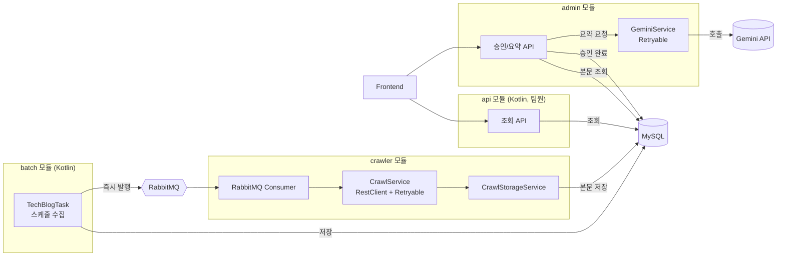

### **퀵스택(QuickStack)**
Service: https://quick-stack-psi.vercel.app/blogs

기술 블로그와 GitHub 릴리즈 노트를  수집하고 기술 블로그의  Gemini API 요약 및  관리자가 검토 발행 서비스입니다.

`2026.03 ~ 2026.06` | 4인 팀 (Backend 2, Frontend 1, UI/UX 1)

## 담당 역할
 
| 영역 | 내용 |
|---|---|
| **admin 모듈** | 전담 개발 (인증, 승인, 요약 요청 API) |
| **crawler 모듈** | 전담 개발 (수집, 파싱, 재시도) |
| **batch 모듈** | RabbitMQ 발행 로직 담당 (수집 로직은 팀원) |
| **api 모듈** | 미담당 (Kotlin, 팀원) |
| **AWS 인프라** | EC2 / RDS / ECR / Secrets Manager / SSM 구성 |
| **CI/CD** | GitHub Actions 기반 빌드-배포 파이프라인 |
 
## 기술 스택
 
Java 21, Kotlin, Spring Boot, Spring Security, MySQL(RDS), RabbitMQ, Docker, AWS, GitHub Actions
 
## 아키텍처
 

 
**멀티모듈 구조로 관심사 분리** — `api`(조회), `admin`(운영/승인), `crawler`(수집), `batch`(스케줄 수집) 모듈이 독립적으로 배포/관리되도록 설계했습니다.
 
**이벤트 기반 처리** — 기존에는 스케줄러가 1분 주기로 DB를 폴링(최대 10건씩)하는 방식이었으나, batch 모듈이 데이터를 저장하는 즉시 RabbitMQ로 발행하고 crawler가 곧바로 소비하는 구조로 전환했습니다. `crawler` 내부의 재탐색 스케줄러는 발행 실패 시에만 동작하는 보조 안전장치입니다.
 
## 성능 개선
 
| | 기존 (폴링) | 개선 (이벤트 기반) |
|---|---|---|
| 방식 | 1분 주기, 배치당 최대 10건 | 저장 즉시 큐 발행 |
| 50건 처리 소요시간 | 이론상 약 4~5분 (조건: 1분 주기·10건/배치) | **실측 약 2.9초** |
 
> 실측 조건: 동일 대상 URL 50건, 로컬 환경, `@TrackExecutionTime`(AOP) 및 타임스탬프 로그 기반 측정
 
## 트러블슈팅
 
**이벤트 기반 처리 전환**

**문제** : 기존에 동작하던 크롤러는 1분마다 DB에서 처리 대상을 최대 10건 조회하는 방식이였습니다.  한번에 많은 양의 데이터가 들어오게 될 경우 여러 주기에 걸쳐 데이터를 처리하거나, 데이터가 없어도 DB 조회를 반복하는 구조였습니다. 

**해결**: 스케줄러 대신 비동기 큐 기반의 메시지 브로커를 도입하였습니다.  Kafka의 경우는 현재 시스템 규모와 비교하여 오버엔지니어링이라 판단하였고, Redis Pub/Sub의 경우는 속도는 빠르지만 서버 장애 발생 시 데이터 유실 위험이 있습니다. 이런 점을 고려하여 RabbitMQ를 최종 선택하였고 도입하였습니다.

**결과**: 폴링 방식에서 RabbitMQ로 변경 하였고, 건당 평균 처리 시간 350ms를 측정 했습니다.

**운영 비용 60% 절감 아키텍처**

**문제:** EC2와 RDS를 24시간 운영하면서 발생하는 비용이 프로젝트 유지에 부담이 됐습니다. 포트폴리오용 프로젝트의 운영 목적과 예산을 고려하여 비용을 줄일 필요가 있었습니다.

**해결:** 상시 운영 대신 야간 운영을 중단하는 방식을 선택했습니다. AWS EventBridge Scheduler와 Lambda를 연동하여 야간에 EC2를 중지 시키고 RDS 에서 운영하던 MYSQL을 EC2 내부 Docker 컨테이너로 이전했습니다.

**결과:** 월 운영 비용을 약 54$에서 20$로 약 60%이상 비용을 절감하였습니다
 
## 테스트
 
crawler·admin 모듈의 서비스 계층을 중심으로 단위테스트를 작성했습니다. (Mockito, MockRestServiceServer 활용)
 
| 모듈 | 패키지 | Line 커버리지 | Branch 커버리지 |
|---|---|---|---|
| crawler | `service` | 100% | 100% |
| admin | `service` | 94% | 60% |
| admin | `ai` | 83% | 75% |
 
(Jacoco 기준 측정)
## 링크
 
- [팀 프로젝트 원본 저장소](https://github.com/Trends-Stack-Summary/Backend)
- [배포된 서비스](https://quick-stack-psi.vercel.app/releases)
